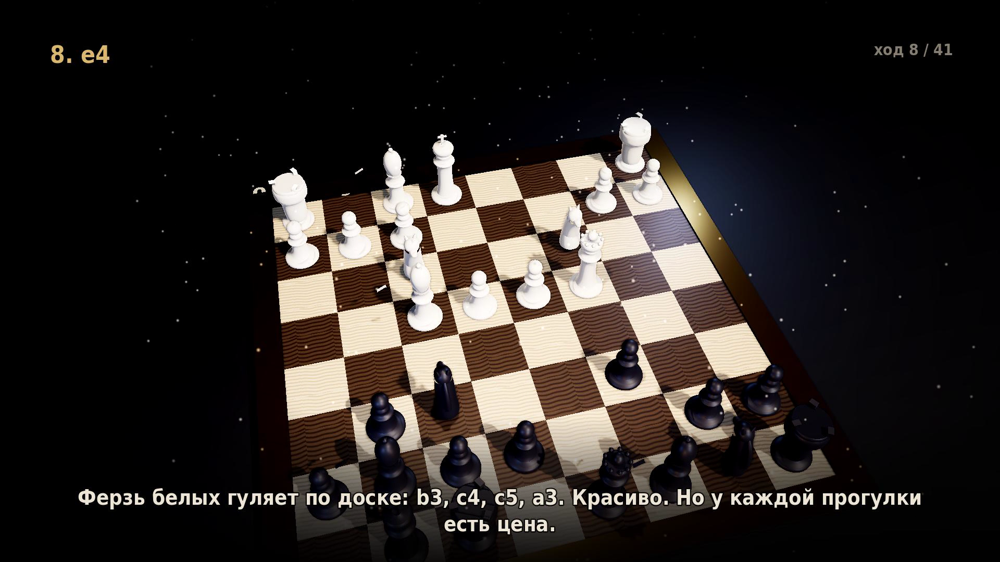
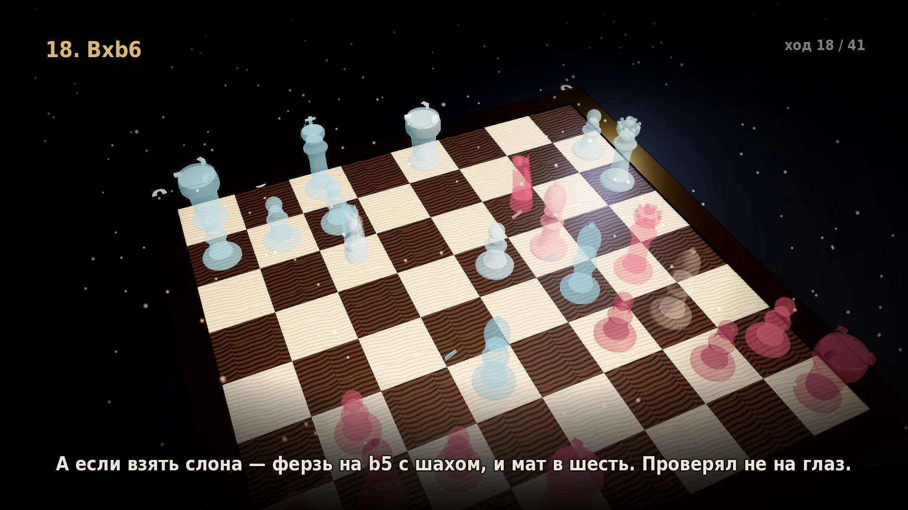

# godot_chess_3d — «11 ходов»

Трёхминутный 3D-ролик, собранный движком по настоящей партии: **MktChess — DenNedelin**, рапид 15+10,
[lichess.org/game/kCpBTaXQ](https://lichess.org/game/kCpBTaXQ). 0–1, мат на одиннадцатом ходу.

Формат — не разбор и не стрим, а «дорогое документальное кино про катастрофу»: тёмная студия,
процедурные фигуры, камера всё время со стороны чёрных, за кадром — спокойный голос, который
изо всех сил сохраняет серьёзное лицо. Музыка — «Сарабанда» Генделя, которая сама заканчивается
вместе с роликом.

## Фильмы

| Ролик | Длительность | О чём | Видео |
|---|---|---|---|
| **11 ходов** | 3:00 | MktChess — DenNedelin, lichess 2026, мат на 11-м ходу | [Vimeo](https://vimeo.com/1242551854) |
| **Партия века** | 4:56 | Byrne — Fischer, Нью-Йорк 1956, жертва ферзя | [Vimeo](https://vimeo.com/1242806403) |

Первый собран на «Сарабанде» Генделя, второй — на «Полёте валькирий» Вагнера,
с новыми типами камеры (якорные планы, орбита вокруг короля) и исчезновением
съеденных фигур: пешки рассыпаются в пыль, кони и слоны улетают в темноту,
ферзь сгорает искрой, король гаснет последним.

Для встраивания на сайт: `docs/embed.html` («11 ходов») и `docs/embed_v2.html` («Партия века»).

| «11 ходов» | «Партия века» |
|---|---|
|  |  |
|  |  |

## Как это сделано

Картинку целиком рисует [Godot 4.6](https://godotengine.org) в режиме Movie Maker: фиксированный
fps, кадр за кадром, без реального времени. Никакой физики и случайностей — состояние сцены на
любой момент вычисляется из времени, поэтому рендер детерминирован и его можно прерывать.

```
PGN ──> tools/parse_pgn.py ──> godot/data/game.json (FEN после каждого хода)
                                        │
godot/scripts/timeline.gd ──────────────┤  планы, реплики, тайминги ходов
                                        ▼
                     godot --write-movie  (5400 кадров, 30 fps)
                                        │
                     ffmpeg ────────────┴─> H.264 CRF 15
                                        │
tools/tts_build.py ──> vo/lines/*.mp3 ──┤
tools/mix_audio.py ─────────────────────┴─> голос + музыка, AAC 256k
```

Фигуры генерируются кодом: тела вращения для пешек, ладей, слонов, ферзя и короля, лофт и труба
по кривой для коня. Внешних моделей и лицензионных ограничений нет.

## Быстрый старт

Нужны Godot 4.6.2 (бинарник в корне, в репозиторий не входит), ffmpeg и Python 3.

```bash
# «Партия века» — второй ролик, 82 полухода
GODOT=./Godot_v4.6.2-stable_linux.x86_64
$GODOT --path godot --headless -- --film=v2 --dump-cues=$PWD/render/cues_v2.json
python3 tools/tts_build.py --voice filipp --cues render/cues_v2.json --dir vo2
$GODOT --path godot --write-movie render/v2.avi --fixed-fps 30 -- --film=v2
python3 tools/mix_audio.py --audio-out render/v2_audio.m4a --music ".../Вагнер.mp3" \
    --music-gain 0.28 --duration 296 --lines vo2/lines.json --out /dev/null

./tools/render.sh preview          # 720p, Compatibility — черновик (~11 мин)
./tools/render.sh final            # 1080p, Forward+ — финал (~45 мин на CPU)
./tools/render.sh stills 20 115    # стоп-кадры в render/stills/
```

Звук:

```bash
python3 tools/tts_build.py --voice filipp --speed 0.96     # нужен ключ Yandex SpeechKit
python3 tools/mix_audio.py \
    --music "путь/к/сарабанде.mp3" --music-gain 0.28 --duration 180 \
    --out render/chess_11_moves_1080p.mp4
```

Ключи TTS кладутся в `tts/.secrets/tts.env` (`YANDEX_API_KEY`, `YANDEX_FOLDER_ID`), в репозиторий
не попадают.

## Структура

```
godot/                  проект: сцена, процедурные фигуры, таймлайн, HUD
  scripts/timeline.gd   «11 ходов»: планы, реплики, расписание
  scripts/timeline_v2.gd «Партия века»: 82 полухода, якоря, орбита, исчезновение фигур
  scripts/main.gd       режиссёр: состояние сцены на момент t (--film=v1|v2)
  data/game.json        партия для первого ролика
  data/game2.json       Byrne — Fischer, разобранная python-chess
  data/captions_v2.json реплики второго ролика (их же читает TTS)
docs/TZ.md              техническое задание и фактические параметры
docs/storyboard.md      раскадровка (генерируется из timeline.gd)
docs/voiceover_ru.md    что и когда звучит
render/subs/            субтитры
render/cues.json        метки: реплики, ходы, тайминги голоса
tools/                  парсер PGN, TTS, микс, сборка
```

## Что проверяется

- Позиция после каждого полухода сверяется с FEN из `python-chess`.
- Отдельно подтверждено: мат в один ход стоял уже после `10…Qd6` — `11.b3` его не отменил,
  материал к тому моменту был равный, 14 против 14. Это и есть сюжет ролика.

## Лицензии и кредиты

- Код — [MIT](LICENSE).
- Шрифт DejaVu Sans Condensed — свободная лицензия Bitstream Vera.
- Музыка: Гендель, «Сарабанда» HWV 437 (общественное достояние). Запись в репозиторий
  не включена — права на конкретное исполнение.
- Озвучка: Yandex SpeechKit, голос `filipp`.

## Ограничения

- Финальный рендер считался на CPU (llvmpipe, без GPU): 0.43 с/кадр, 43 минуты на три минуты видео.
- Визуальные приколы из ТЗ — бейджи «!!/??» и красная стрелка b3→h2 — остались в бэклоге.
- Фоли (щелчки фигур, падение короля) не синтезировался: только голос и музыка.
